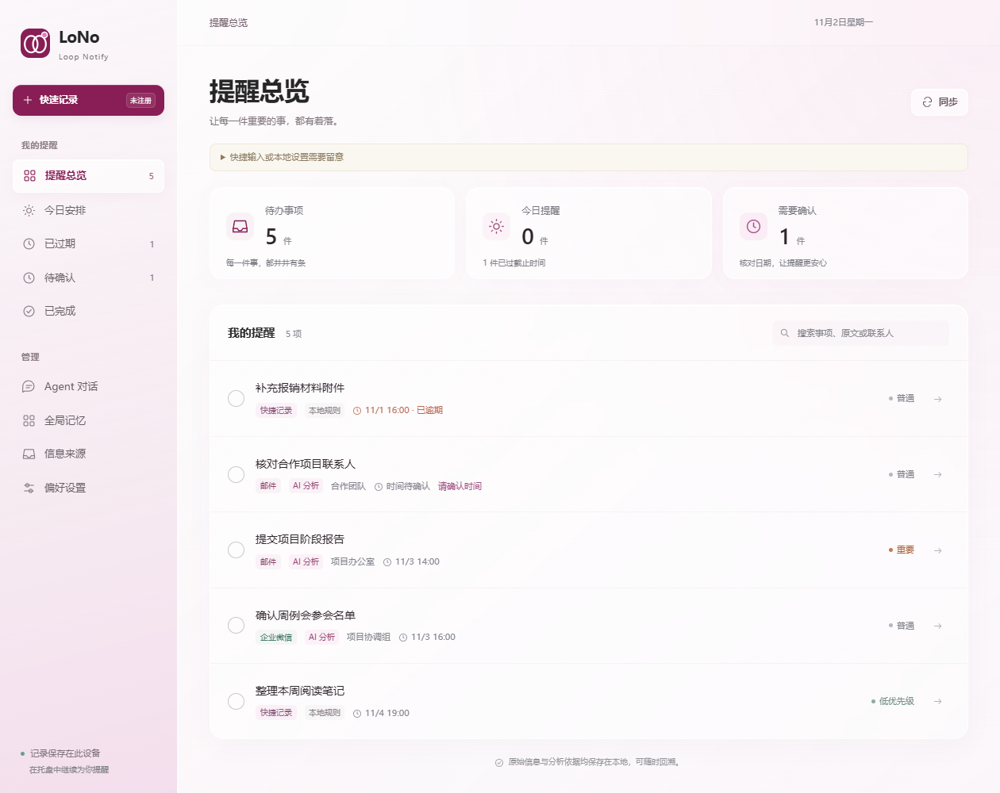
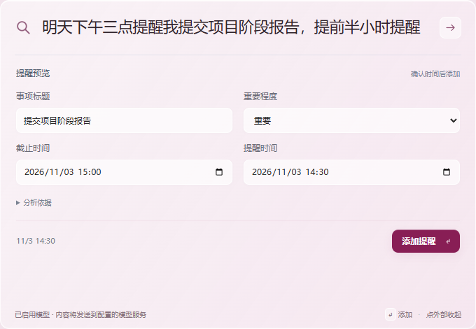
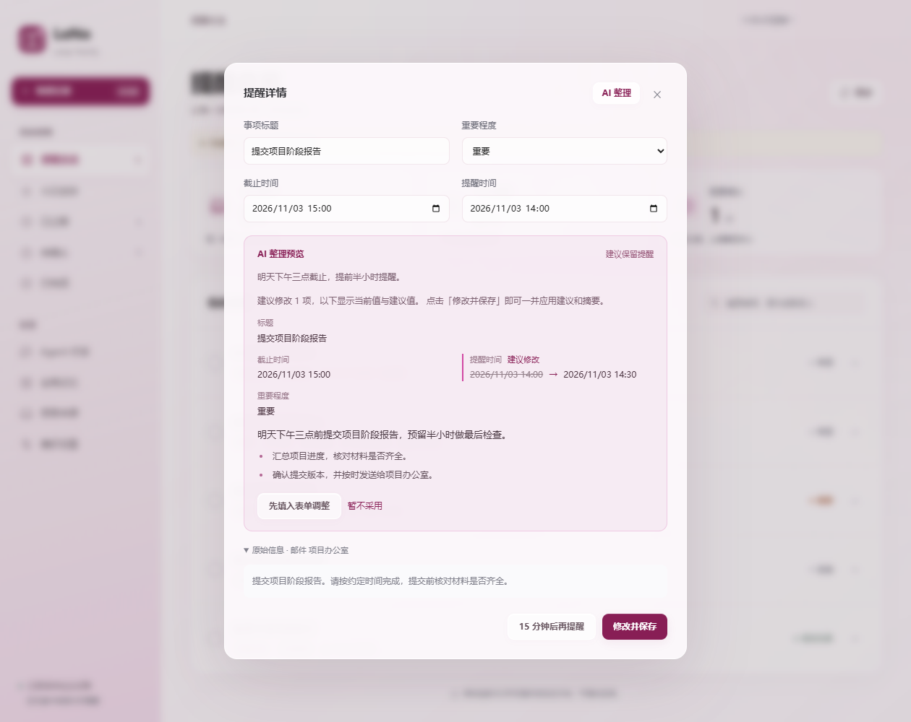
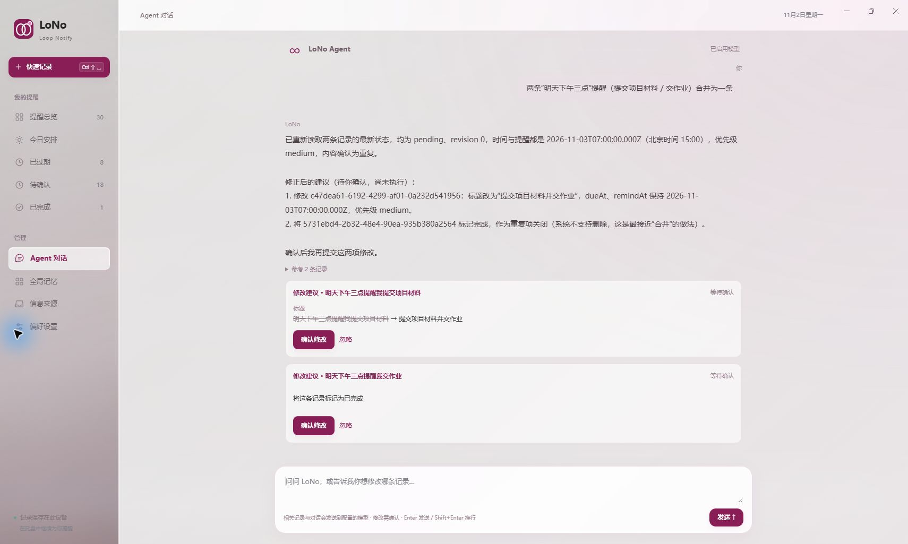
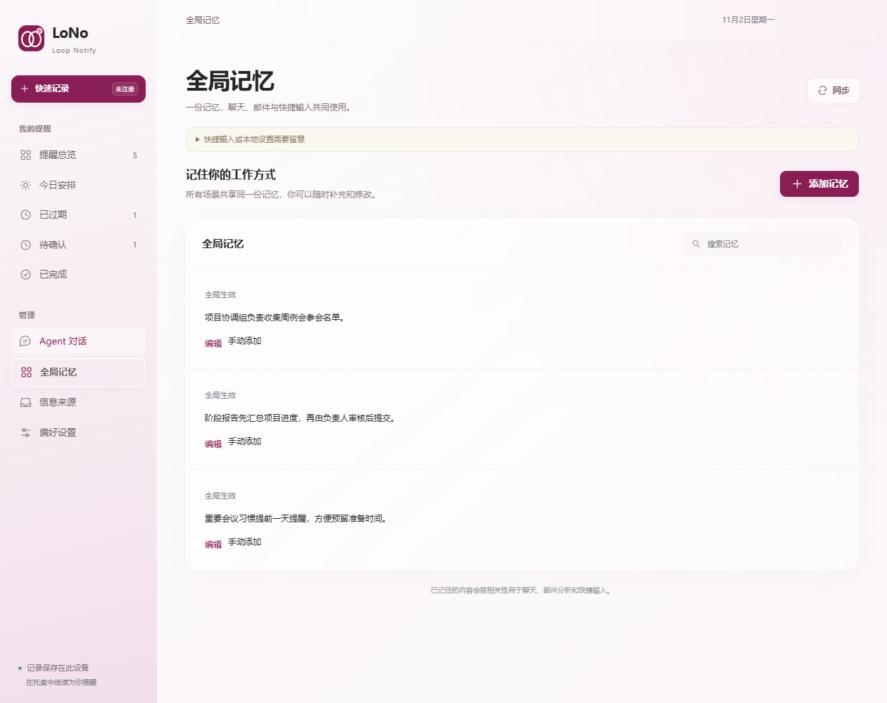

# LoNo

**Keep important work on track.**

Loop Notify · Your intelligent desktop reminder assistant

Extract tasks from emails and messages, use AI to organize titles, dates and key points, and turn scattered information into clear plans.

[简体中文](README.md) | **English**

[Download](https://github.com/wangjt23/LoNo/releases) · [Quick start](#quick-start) · [Features](#features)

## From a sentence to a scheduled task

“Remind me to submit the project progress report tomorrow at 3 p.m., with a reminder 30 minutes early.”

Open Quick Capture and describe what you need. LoNo helps organize the title, deadline and reminder time for you to review and save. If the time is unclear, capture the task first and fill it in later under Pending confirmation.

  

The offline parser supports common Chinese date and time expressions. For other languages and more complex messages, enable a model and review its suggestions before saving.

## Features

| What you want to do | How LoNo helps |
| :--- | :--- |
| Capture a task quickly | Open Quick Capture with a global shortcut, type naturally, then review and save. |
| Keep track of your plans | Switch between Overview, Today, Overdue and Pending confirmation; search source text, complete tasks or snooze reminders. |
| Extract tasks from messages | Sync email and authorized message bridges to identify actions, titles, deadlines, reminder times and priorities. |
| Reorganize with AI | Revisit the original message and relevant memories, then review suggested fields, a summary and key points together. |
| Think through your work in chat | Ask the Agent to find records, analyze plans and propose changes for your approval. |
| Remember how you work | Save preferences, workflows and responsibilities so approved memories can inform future analysis. |
| Trace a task to its source | Review the original email, message or quick note alongside its summary and analysis. |

### Turn messages into actionable tasks

Connect an email account or an authorized message bridge. LoNo syncs new information at the configured interval, identifies actions and extracts the task title, deadline, reminder time and priority. With AI enabled, it also summarizes the original text and highlights key points.

Informational messages remain available as source records. Tasks without a clear time appear under Pending confirmation. Each task retains its source for review, and syncing does not change email read status. Reusable preferences, workflows and responsibilities can also become memory candidates for you to approve.

### Use AI to clarify the next action

Open a reminder and click **AI Organize (AI 整理)**. LoNo uses the original text, message date and relevant approved memories to reconsider the title, deadline, reminder time and priority, and generate a summary with key points.

The preview shows current and suggested values. Review them and click **Apply and Save (修改并保存)**, fill the suggestions into the form for further editing, or dismiss them. A suggestion that no action is needed also requires explicit confirmation.

### Work through your plans with the Agent

Try asking, “Find records about reimbursement” or “What should I prioritize next?” The Agent can search local records, read original messages and suggest changes. Edits to titles, times, priorities and completion status are presented for your approval.

For example, ask it to merge two duplicate reminders for tomorrow at 3 p.m. The Agent reads the current records, proposes which task to retain and which duplicate to close, and displays change cards. The changes run only after you confirm them.

### Help your assistant learn how you work

Need a reminder one day before important meetings? Does a progress report need a supervisor's review first? Keep these preferences and workflows in Global Memory. Chat, email analysis and Quick Capture share approved memories, which you can review, edit or delete at any time.

The Agent merge example is captured from an actual conversation in the running app; other screenshots use fictional demonstration data. Screenshots show the current Chinese-language interface on Windows. The macOS window appearance may differ.

## Quick start

1. **Capture your first task.** Click Quick Capture, enter the task and time, press Enter to preview, then review and click Add Reminder.
2. **Work at your own pace.** View today's plans, mark tasks complete or snooze a reminder for 15 minutes.
3. **Connect AI when you need it.** Enter your model endpoint, model name and API key in Preferences. Agent chat, AI summaries and AI organization require a model; local Chinese parsing works without one.
4. **Connect your information sources.** Configure IMAP, Exchange / EWS or an authorized WeCom message bridge, and check sync results under Information Sources.

### Keyboard shortcuts

| Action | Windows | macOS |
| :--- | :--- | :--- |
| Open Quick Capture | `Ctrl + Shift + Space` | `Command + Shift + Space` |
| Fallback shortcut | `Ctrl + Alt + Space` | `Command + Option + Space` |
| Search tasks | `Ctrl + F` | `Command + F` |
| Analyze input and show a preview | `Enter` | `Enter` |
| Insert a new line | `Shift + Enter` | `Shift + Enter` |
| Dismiss Quick Capture | `Esc` | `Esc` |

If a shortcut is unavailable, the app shows the fallback or conflict status. You can also use the Quick Capture button. Clicking outside the capture window or pressing Esc discards unsaved input.

## Download and install

Visit **[GitHub Releases](https://github.com/wangjt23/LoNo/releases)** for release notes and downloads.

| Platform | Installation | Status |
| :--- | :--- | :--- |
| Windows · x64 | Extract the ZIP and run `LoNo.exe`, or use the Setup installer. | Preview builds are available on Releases. |
| macOS · Apple Silicon / Intel | Open the matching DMG and drag LoNo into Applications. | Both architectures are available on Releases. |

Keep the entire folder when using the Windows ZIP. Before updating, quit the old version from the tray or application menu.

Windows builds do not have a trusted publisher signature. Mac builds use ad-hoc signing and are not notarized by Apple. Your system may warn about or block them. See the [Windows signing guide](WINDOWS-SIGNING.md) and [macOS guide](MACOS.md), currently in Chinese.

## Your records, under your control

- **Local storage.** Tasks, source records and memories are stored in a local database. Connection secrets use operating-system encryption. Record exports do not include connection secrets.
- **Optional AI.** When enabled, relevant input, source text, conversation and retrieved memories are sent to your configured model service. Offline parsing requires no model connection.
- **Review important changes.** Quick Capture provides a preview; Agent changes require approval. Automatically extracted memory candidates are used only after you approve them.
- **Read-only email collection.** LoNo does not send emails, change read status, move messages or delete mail. WeCom requires an authorized conversation archive service or message bridge.

Closing the main window keeps LoNo running in the tray or menu bar. **Reminders cannot be delivered while the app is fully quit, the computer is shut down or the computer is asleep.** LoNo checks missed reminders on startup and wake. Test desktop notifications in Preferences when you first set up the app.

## FAQ

**Do I have to configure AI?**

No. Local rules understand common Chinese dates and advance-reminder expressions. Agent chat, AI summaries and AI organization require an enabled model.

**Can I capture a task without a time?**

Yes. Tasks with neither a deadline nor a reminder time go to Pending confirmation. Review vague expressions such as “end of the month” or “before leaving work” and set a concrete time.

**Which sources can I connect?**

IMAP / TLS and Exchange / EWS email accounts, plus WeCom messages through an authorized JSON bridge. Availability depends on your organization's services and permissions.

**Does LoNo sync across devices?**

LoNo currently focuses on local use and has no built-in cloud sync. You can export records; see the technical reference for backup details. Recurring reminders and attachment recognition are not currently supported.

## License

LoNo is released under the [MIT License](LICENSE).

---

To run from source or contribute, see the [development and technical reference](docs/DEVELOPMENT.md), [validation notes](VALIDATION.md), or [open an issue](https://github.com/wangjt23/LoNo/issues). The technical guides are currently in Chinese.
