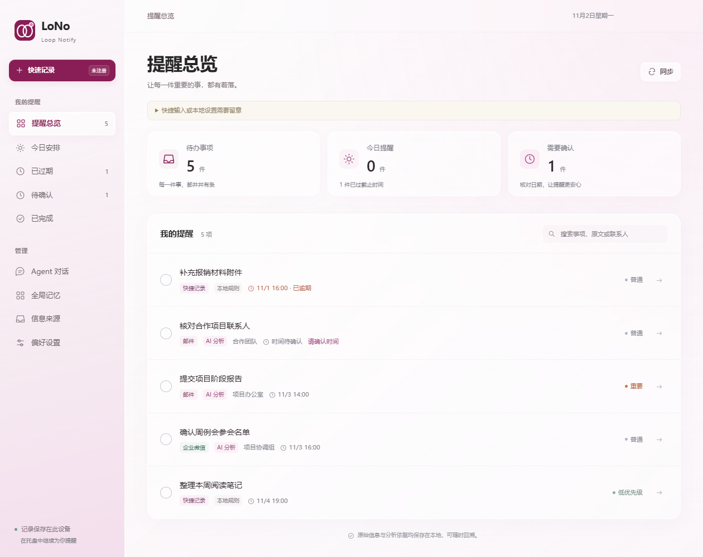
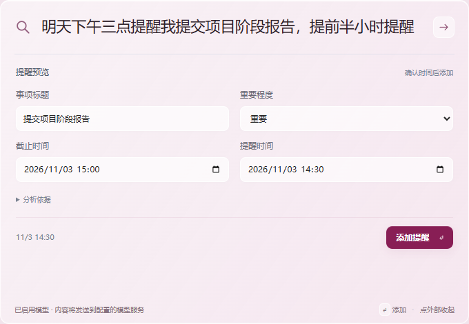
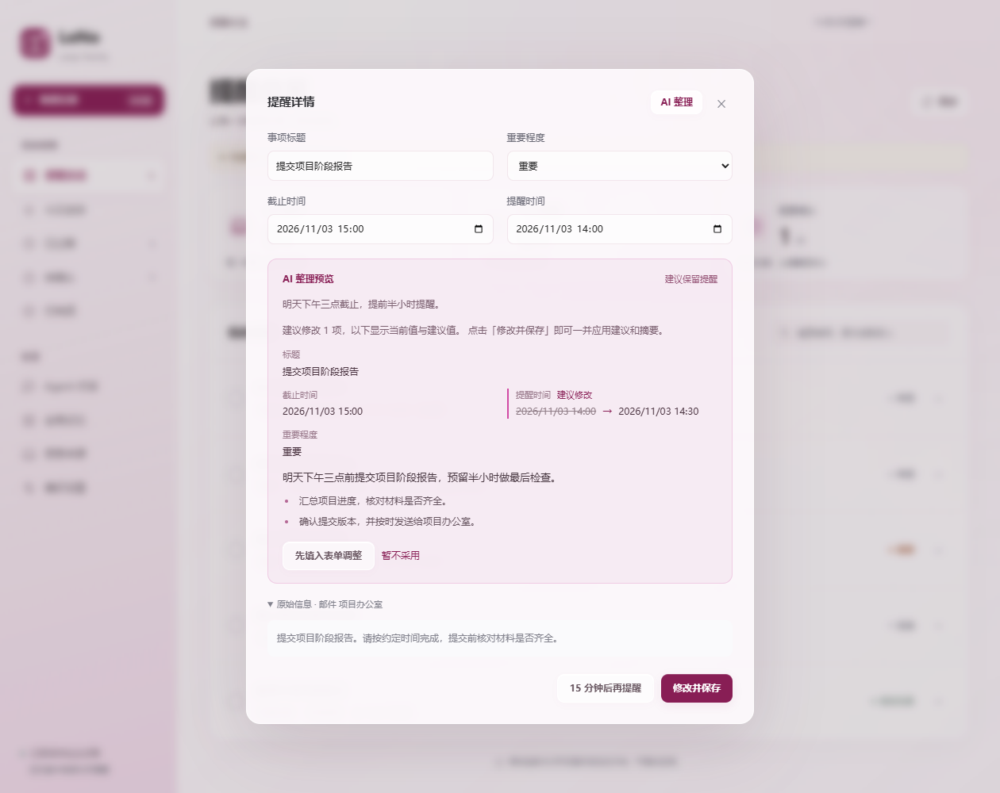
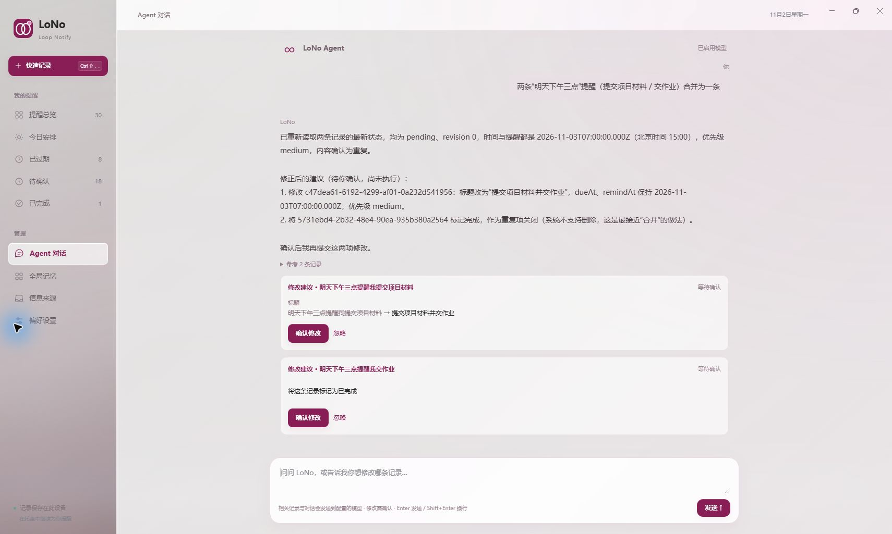
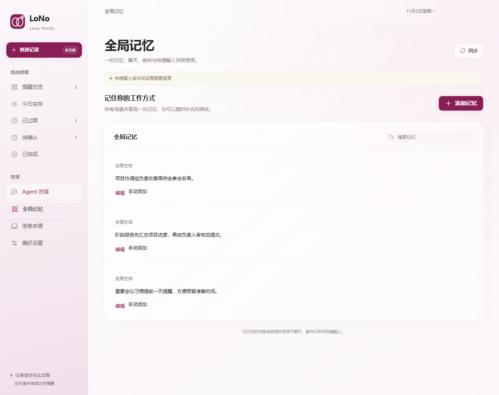

# LoNo

**让每一件重要的事，都有着落。**

Loop Notify · 你的桌面智能提醒助手

自动提取邮件与消息中的待办，一键 AI 整理标题、时间和要点，把分散的信息变成清晰的安排。

**简体中文** | [English](README.en.md)

[下载体验](https://github.com/wangjt23/LoNo/releases) · [快速上手](#快速上手) · [功能一览](#功能一览)

## 从一句话，到一件安排好的事

「明天下午三点提醒我提交项目阶段报告，提前半小时提醒。」

唤起快速记录，像平时说话一样输入。LoNo 帮你整理标题、截止时间和提醒时间，确认后保存。来不及想清楚时间也没关系，先记下，稍后在「待确认」里补充。

  

## 功能一览

| 想做的事 | LoNo 可以帮你 |
| :--- | :--- |
| 随手记下任务 | 全局快捷键唤起输入框，用自然语言记录，预览后确认保存。 |
| 看清手头安排 | 在总览、今日安排、已过期和待确认之间切换，搜索原文，完成或延后提醒。 |
| 自动提取待办信息 | 定期同步邮件和已授权的消息桥接，识别是否需要行动，提取任务标题、截止时间、提醒时间和重要程度。 |
| 一键 AI 整理 | 重新理解原文和相关记忆，一次整理标题、时间、重要程度与摘要，核对建议后保存。 |
| 在对话中理清思路 | 请 Agent 查找记录、分析安排、提出修改建议；修改前由你确认。 |
| 记住工作方式 | 保存习惯、流程和人物分工，让已确认的记忆参与后续分析。 |
| 回看任务从哪来 | 从事项回到邮件、聊天或快捷记录，核对原文、摘要和分析依据。 |

### 自动提取信息，让待办从消息里浮现

连接邮箱或已授权的消息桥接后，LoNo 会按设定的频率同步新信息，识别哪些内容需要行动，提取任务标题、截止时间、提醒时间和重要程度。启用 AI 后，还能概括原文、生成要点摘要，减少来回翻找通知的时间。

资讯类内容保留为来源记录，没有明确时间的待办进入「待确认」。每条事项都保留原始信息，方便回看核对；同步读取不会修改邮件已读状态。邮件中可复用的习惯、流程与分工也可提炼为记忆候选，经你确认后使用。

### 一键 AI 整理，把原文变成清楚的行动

打开一条提醒，点击 **「AI 整理」**。LoNo 会结合原文、消息时间和相关的已确认记忆，重新梳理任务标题、截止时间、提醒时间和重要程度，同时生成摘要与重点。

整理结果会显示当前值与建议值。核对后点击 **「修改并保存」** 即可一并应用；也可以先填入表单继续调整，或选择暂不采用。若 AI 判断无需处理，仍需你明确确认。

### 和 Agent 一起梳理安排

试着问：「帮我找一下有关报销的记录」「接下来有哪些事需要优先处理？」Agent 可以检索本地记录、阅读原文并给出建议。涉及标题、时间、重要程度或完成状态的修改，会展示建议并等待你确认。

例如，请它把两条重复的「明天下午三点」提醒合并。Agent 会重新读取记录，提出保留事项和关闭重复项的建议，通过修改卡片展示结果，等你确认后才执行。

### 让助理逐渐熟悉你的工作方式

重要会议需要提前一天提醒？阶段报告需要先由负责人审核？把这些习惯和流程留在「全局记忆」里。聊天、邮件分析和快捷记录共享已确认的记忆，你也可以随时查看、编辑和删除。

Agent 合并示例截自当前应用与模型的实际对话，其他截图使用虚构演示数据。截图取自 Windows，macOS 的窗口外观以实际运行效果为准。

## 快速上手

1. **记下第一件事。** 点击「快速记录」，输入任务和时间，按 Enter 查看预览，核对后点击「添加提醒」。
2. **按自己的节奏处理。** 在「今日安排」查看当天事项，完成后勾选；暂时不方便处理时，可以延后 15 分钟。
3. **按需连接 AI。** 在「偏好设置」填写模型地址、模型名称和 API Key。启用后可使用 Agent 对话、AI 整理和摘要；不配置模型也能用本地中文规则记录提醒。
4. **把信息接进来。** 添加一个或多个邮箱，为每个邮箱选择 IMAP 或 Exchange / EWS 并设置别名，或接入企业微信授权数据桥接，在「信息来源」查看同步结果。

### 常用快捷键

| 操作 | Windows | macOS |
| :--- | :--- | :--- |
| 唤起快速记录 | `Ctrl + Shift + Space` | `Command + Shift + Space` |
| 备用唤起键 | `Ctrl + Alt + Space` | `Command + Option + Space` |
| 搜索事项 | `Ctrl + F` | `Command + F` |
| 输入并查看预览 | `Enter` | `Enter` |
| 在输入框换行 | `Shift + Enter` | `Shift + Enter` |
| 收起快速记录 | `Esc` | `Esc` |

快捷键冲突时，界面会提示可用的备用组合；也可以随时点击「快速记录」。点击其他窗口或按 Esc 会丢弃尚未保存的快速输入。

## 下载与安装

前往 **[GitHub Releases 下载页面](https://github.com/wangjt23/LoNo/releases)**，查看版本说明和可用安装包。

| 平台 | 安装方式 | 当前状态 |
| :--- | :--- | :--- |
| Windows · x64 | 下载 ZIP 后解压并运行 `LoNo.exe`，或使用 Setup 安装包。 | 预发布版，具体文件以 Releases 为准。 |
| macOS · Apple Silicon / Intel | DMG 拖拽安装。 | Apple Silicon 与 Intel DMG 均已发布，具体文件以 Releases 为准。 |

使用 ZIP 版本时请保留完整文件夹。更新前，从托盘或应用菜单退出旧版，再启动新版。

当前测试包尚未完成可信发布签名，系统可能提示或阻止打开。安装与签名说明见 [Windows 安装说明](WINDOWS-SIGNING.md) 和 [macOS 构建说明](MACOS.md)。

## 你的记录，由你掌握

- **记录保存在本机。** 提醒、来源和记忆保存在本地数据库，连接密钥使用系统凭据加密。「导出记录」可导出事项与来源，不包含连接密钥。
- **是否使用 AI，由你决定。** 启用模型后，相关输入、来源正文、对话及检索到的记忆会发送到你配置的模型服务。离线规则无需模型连接。
- **重要修改先确认。** 快速输入先预览，Agent 修改先确认；自动提炼的记忆候选经你确认后才参与后续分析。
- **邮箱采集只读。** 不发送邮件、不修改已读状态、不移动或删除邮件。企业微信需接入已授权的会话存档服务或数据桥接。

关闭主窗口后，LoNo 会继续在托盘或菜单栏运行。**彻底退出、关机或休眠期间无法发送提醒**，启动和唤醒时会检查错过的事项。建议首次使用时，在偏好设置中测试桌面通知。

## 常见问题

**一定要配置 AI 吗？**

不需要。常见中文日期和提前提醒表达可以通过本地规则解析。Agent 对话、AI 摘要和 AI 整理需要启用模型。

**没有明确时间，能先记下来吗？**

可以。没有截止时间和提醒时间的事项会进入「待确认」，方便稍后补充。像「月底」「下班前」这样的模糊表达，建议确认成具体时间。

**可以连接哪些信息来源？**

支持 IMAP / TLS 和 Exchange / EWS 邮箱，也可通过已授权的 JSON 数据桥接接入企业微信消息。实际连接能力取决于所在组织的服务配置与权限。

**可以跨设备自动同步吗？**

目前以本地使用为主，没有内置跨设备云同步。可以导出记录；完整备份方式见技术参考。重复提醒和附件识别也尚未提供。

## 开源许可

本项目采用 [MIT License](LICENSE) 开源许可。

---

想从源码运行或参与改进？查看 [开发与技术参考](docs/DEVELOPMENT.md)、[验证说明](VALIDATION.md)，或 [提交问题与建议](https://github.com/wangjt23/LoNo/issues)。
